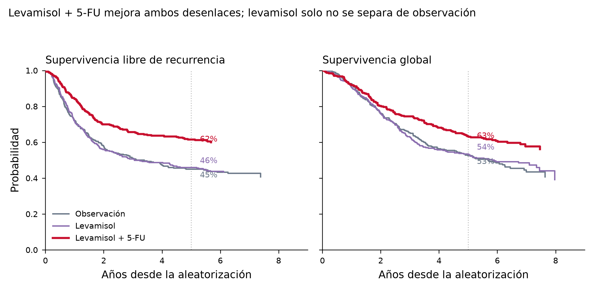

# El ensayo tras `survival::colon`: dossier verificado

Los 929 pacientes del conjunto `colon` del paquete `survival` de R corresponden al estrato en estadio III
(Dukes C) del ensayo Intergroup 0035, conducido por el North Central Cancer Treatment Group, el Southwest
Oncology Group y el Eastern Cooperative Oncology Group, cuyo informe final apareció en *Annals of Internal
Medicine* en 1995 ([Moertel et al. 1995](https://doi.org/10.7326/0003-4819-122-5-199503010-00001); PMID
7847642). Las cuatro cifras del informe de 1995 que se querían comprobar —929 pacientes, seguimiento mediano
de 6,5 años, reducción del 40 % en recurrencia y del 33 % en mortalidad con 5-FU + levamisol, y reducciones de
solo 2 % y 6 % con levamisol en monoterapia— **son correctas tal como figuran en el resumen indexado en
PubMed**, igual que las dos cifras del informe de 1990 en *New England Journal of Medicine* (−41 % recurrencia,
−33 % mortalidad en estadio C). Lo que **no** pude verificar es el segundo bloque de la petición: hazard ratios,
intervalos de confianza, supervivencia a 5 años por brazo, tamaños de brazo y método de cálculo no aparecen en
ningún texto accesible desde este entorno, porque ambos artículos están tras muro de pago. Para cerrar ese hueco
reanalicé el propio conjunto `survival::colon`, que reproduce tres de las cuatro reducciones publicadas con una
diferencia inferior a un punto porcentual.

---

## 1. Verificación de las cifras citadas

### Moertel 1990, *N Engl J Med*

[Moertel et al. 1990](https://doi.org/10.1056/NEJM199002083220602) (PMID 2300087) se publicó en el volumen 322,
páginas 352–358, confirmado tanto por el registro de PubMed como por el de CrossRef, que devuelve
`volume: 322`, `page: 352-358`, `issued: 1990` y ningún aviso de retractación o corrección (`update-to` vacío).

| Afirmación a verificar | Veredicto | Lo que dice la fuente |
|---|---|---|
| Volumen y página 322:352 | **Confirmado** | CrossRef: vol. 322, pp. 352–358, 1990 |
| Estadio C: recurrencia −41 % | **Confirmado** | Resumen: reducción del 41 % del riesgo de recurrencia, *P* < 0,0001 |
| Estadio C: mortalidad −33 % | **Confirmado** | Resumen: reducción del 33 % de la tasa global de muerte, *P* ≈ 0,006 |

Dos matices que conviene arrastrar al informe. Primero, el denominador de 1990 no es el del conjunto de datos:
el ensayo aleatorizó 1 296 pacientes con cáncer de colon resecado localmente invasivo (estadio B2) o con
afectación ganglionar regional (estadio C), y solo los de estadio C podían ser asignados además al brazo de
levamisol en monoterapia. Segundo, el seguimiento mediano en ese momento era de 3 años (rango 2 a 5,5), de modo
que las cifras de 1990 y las de 1995 no son la misma medición con más tiempo de observación sobre la misma
población, sino análisis sobre cohortes de distinto tamaño y madurez. El resumen añade que el levamisol solo no
tuvo efecto detectable y que los resultados en B2 eran equívocos y demasiado preliminares.

### Moertel 1995, *Ann Intern Med*

[Moertel et al. 1995](https://doi.org/10.7326/0003-4819-122-5-199503010-00001) (PMID 7847642) se publicó en el
volumen 122, número 5, páginas 321–326; CrossRef devuelve `volume: 122`, `page: 321-326`, `issued: 1995`, sin
`update-to`.

| Afirmación a verificar | Veredicto | Lo que dice la fuente |
|---|---|---|
| 929 pacientes | **Confirmado** | Resumen: «all 929 eligible patients» |
| Seguimiento mediano 6,5 años | **Confirmado** | Resumen: mediana de seguimiento 6,5 años, todos seguibles ≥ 5 años |
| Recurrencia −40 % | **Confirmado** | Resumen: 40 %, *P* < 0,0001 |
| Muerte −33 % | **Confirmado** | Resumen: 33 %, *P* = 0,0007 |
| Levamisol solo: −2 % recurrencia | **Confirmado** | Resumen: «reduced the recurrence rate by only 2 %» |
| Levamisol solo: −6 % muerte | **Confirmado** | Resumen: «the death rate by only 6 %» |

El resumen precisa además el régimen, que no siempre se transcribe bien en la literatura secundaria: levamisol
50 mg por vía oral tres veces al día durante 3 días, repetido cada 2 semanas durante un año; 5-fluorouracilo
450 mg/m² de superficie corporal por vía intravenosa diaria durante 5 días y, a partir del día 28, semanal
durante 48 semanas. Los pacientes entraban tras resección con intención curativa realizada en las 1 a 5 semanas
previas.

Conviene registrar un detalle de procedencia que se pierde con facilidad: el estrato de estadio II (Dukes B2) del
mismo ensayo INT-0035 **no** está en el informe de *Annals*, sino en un artículo independiente del mismo año con
318 pacientes evaluables y seguimiento mediano de 7 años, donde la reducción de la recurrencia fue del 31 % sin
alcanzar significación (*P* = 0,10) y la mortalidad fue esencialmente idéntica entre brazos, 43 frente a 44
muertes ([Moertel et al. 1995, *J Clin Oncol*](https://doi.org/10.1200/JCO.1995.13.12.2936); PMID 8523058). Esto
importa para el punto 3: los 929 registros del conjunto de datos son el estrato III, no el ensayo completo.

---

## 2. Estimaciones de efecto del informe de 1995

**No verificable con las fuentes disponibles.** El texto completo de *Annals of Internal Medicine* 1995;122:321–326
no es accesible desde este entorno. Las rutas que intenté y su resultado:

| Ruta | Resultado |
|---|---|
| Unpaywall | omitida (no se facilitó dirección de contacto) |
| Semantic Scholar | HTTP 200, sin `openAccessPdf` |
| PubMed Central | sin PMCID asociado a PMID 7847642 |
| CrossRef TDM | sin enlaces de minería de texto |
| Resolución directa del DOI | HTTP 403 |

El resumen indexado, que es la única porción del artículo a la que tengo acceso textual, **no contiene** hazard
ratios, intervalos de confianza, supervivencia a 5 años por brazo, número de pacientes por brazo ni una
descripción del método estadístico. Solo da los cuatro porcentajes de reducción con sus valores de *P*. Por tanto,
cualquier HR o cifra de supervivencia a 5 años que se atribuya a este artículo en el dossier estaría sin
respaldo, y no la incluyo.

Lo que sí puede afirmarse, marcado explícitamente como inferencia y no como cita, es la forma del cálculo. Las
«reducciones» de este ensayo son prácticamente con seguridad 100 × (1 − HR) de un modelo de riesgos
proporcionales de Cox, porque el conjunto de datos público las reproduce casi exactamente bajo esa definición
(sección 3). Cabe señalar también que el ensayo tenía un comité de monitorización y análisis intermedios —el
informe de 1990 se publicó precisamente tras uno—, de modo que los valores de *P* finales no deben interpretarse
como si procedieran de un único análisis planificado al final. Esta última observación es contextual y no la
pude verificar en el texto.

Si se necesita el detalle numérico original, las vías realistas son el acceso institucional a acpjournals.org o
a la base ACCENT (Adjuvant Colon Cancer ENdpoinTs), que incorpora los pacientes de este ensayo entre los 14 611
de doce ensayos norteamericanos ([Yothers et al. 2011](https://doi.org/10.1093/jnci/djr310); PMID 21997132).

---

## 3. Documentación de `survival::colon`

La ficha de ayuda de la versión 3.8.12 del paquete se titula «Chemotherapy for Stage B/C colon cancer» y describe
los datos como procedentes de «uno de los primeros ensayos exitosos de quimioterapia adyuvante para cáncer de
colon», con dos registros por persona, uno de recurrencia (`etype == 1`) y otro de muerte (`etype == 2`). La nota
de procedencia dice textualmente que el estudio se describe originalmente en Laurie (1989), que el informe
principal es Moertel (1990), que «este conjunto de datos es el más próximo al del informe final en Moertel (1991)»
y que una versión con menos seguimiento fue la empleada por Lin (1994).

Esa nota contiene varios errores bibliográficos que conviene corregir en cualquier material derivado:

| En la ficha de ayuda | Correcto | Verificación |
|---|---|---|
| «New England J of Medicine, **332**:352-358, 1990» | volumen **322** | CrossRef, DOI 10.1056/NEJM199002083220602 |
| «resection of stage **II** colon carcinoma: a final report» | estadio **III** | PubMed/CrossRef, PMID 7847642 |
| «Annals of Internal Med, 122:321-326, **1991**» | **1995** | CrossRef, `issued: 1995` |
| Título «Stage B/C colon cancer» | los 929 registros son **solo** estadio III | el estrato B2 (n = 318) se publicó aparte, PMID 8523058 |

La viñeta principal del paquete repite la atribución inexacta: en `doc/survival.Rnw` se lee que «el conjunto de
datos de cáncer de colon tiene 929 sujetos con cáncer de colon en estadio B/C». La cifra de 929 coincide con el
informe final de estadio III, no con la cohorte B2+C de 1990 (1 296 pacientes), de modo que la etiqueta «B/C» es
un residuo del encabezado del ensayo y no describe la población contenida en el objeto.

La propia ficha advierte de una inconsistencia interna señalada por Peter Higgins entre `nodes` y `node4`, que los
mantenedores decidieron no corregir. Contándola sobre los datos: de los 911 pacientes con `nodes` registrado, 12
son discordantes —9 tienen `node4 = 1` con 4 ganglios positivos o menos y 3 tienen `node4 = 0` con 5 o más—.
Además hay 2 pacientes con `nodes = 0` pese a tratarse de una cohorte con afectación ganglionar, 18 pacientes sin
`nodes` y 23 sin `differ`.

### Conjunto de datos frente a población publicada

El objeto tiene 1 858 filas y 929 identificadores únicos, que se reparten en 315 pacientes en observación, 310 en
levamisol y 304 en levamisol + 5-FU. El seguimiento va de 0,06 a 9,11 años y la mediana estimada por
Kaplan-Meier inverso es de 6,44 años, compatible con los 6,5 años publicados. Los eventos observados son 177,
172 y 119 recurrencias y 168, 161 y 123 muertes en los brazos de observación, levamisol y levamisol + 5-FU
respectivamente.

Ajustando modelos de Cox sobre estos datos se recuperan las reducciones publicadas con una fidelidad que apoya
la interpretación del apartado 2:

| Desenlace | Brazo | HR cruda (IC 95 %) | Reducción | HR ajustada (IC 95 %) | Reducción | Publicado 1995 |
|---|---|---|---|---|---|---|
| Recurrencia | Lev + 5-FU | 0,60 (0,47–0,76) | 40,1 % | 0,60 (0,47–0,77) | 39,8 % | 40 % |
| Recurrencia | Levamisol | 0,99 (0,80–1,22) | 1,5 % | 0,94 (0,76–1,17) | 5,5 % | 2 % |
| Muerte | Lev + 5-FU | 0,69 (0,55–0,87) | 31,0 % | 0,69 (0,55–0,88) | 30,7 % | 33 % |
| Muerte | Levamisol | 0,97 (0,78–1,21) | 2,6 % | 0,93 (0,75–1,17) | 6,6 % | 6 % |

El modelo ajustado incluye sexo, edad, obstrucción, perforación, adherencia a órganos vecinos, número de ganglios
positivos, grado de diferenciación, extensión local y tiempo desde la cirugía hasta el registro, y se ajusta sobre
los 888 pacientes sin valores faltantes en esas variables. La reducción del 40 % en recurrencia se reproduce
exactamente; la del 33 % en mortalidad sale 31 % sin ajustar y 30,7 % ajustada, una discrepancia de unos dos
puntos que probablemente refleje un conjunto de covariables o una estratificación distintos de los del análisis
original, algo que no puedo comprobar sin el texto completo. Las dos cifras del levamisol en monoterapia están
dentro del rango de lo publicado, aunque el 2 % de recurrencia coincide con el modelo sin ajustar y el 6 % de
muerte con el ajustado, lo que impide deducir cuál de los dos se usó en el artículo.

Las curvas de Kaplan-Meier por brazo dan una supervivencia global a 5 años del 52,6 % (IC 95 % 47,3–58,4) en
observación, 53,5 % (48,3–59,4) con levamisol y 63,4 % (58,2–69,1) con levamisol + 5-FU; para supervivencia libre
de recurrencia, 45,0 % (39,8–50,9), 46,0 % (40,7–52,0) y 61,5 % (56,2–67,3).

 **Estas cifras son un cálculo propio
sobre el conjunto de datos público, no una cita del artículo de 1995**, y pueden diferir de las publicadas si el
análisis original usó una definición de desenlace o un conjunto de pacientes ligeramente distinto.

---

## 4. Reutilizaciones metodológicas del conjunto

El uso más antiguo documentado es el de [Lin 1994](https://doi.org/10.1002/sim.4780132105) (PMID 7846422), que
desarrolla el enfoque marginal de Cox para datos de fallo multivariantes —modelos marginales por tipo de evento
con varianzas robustas, en la línea de Wei–Lin–Weissfeld— y que, según la propia ficha de ayuda del paquete,
empleó una versión de estos datos con menos seguimiento. Esa es exactamente la estructura que justifica los dos
registros por paciente del objeto `colon`.

En riesgos competitivos y modelos multiestado, la referencia reciente más directa es
[Therneau et al. 2024](https://doi.org/10.1177/17407745241267862) (PMID 39095982), que usa explícitamente los
conjuntos `colon`, `myeloid` y `rhDNase` del paquete `survival` para ilustrar modelos de riesgos multiestado,
ajustando un modelo de riesgos proporcionales por transición y derivando riesgos absolutos, número esperado de
visitas a cada estado y tiempo esperado en cada estado. Es la fuente más útil si el objetivo del portfolio es
precisamente un análisis multiestado sobre estos datos, porque el autor principal es el mantenedor del paquete y
el código es reproducible sobre el mismo objeto.

En la misma familia de desenlaces, [Mao 2023](https://doi.org/10.1111/biom.13570) (PMID 34562019) utiliza el
ensayo como primer ejemplo real del «restricted mean time in favor of treatment», una medida de efecto no
paramétrica que generaliza el tiempo medio restringido de supervivencia al caso de historias clínicas con estados
intermedios; el texto completo en PMC describe el ejemplo como un ensayo histórico de levamisol y fluorouracilo
con 929 pacientes en estadio C y recaída y muerte como desenlaces.

Dentro del propio paquete, la viñeta `concordance.Rnw` ajusta `coxph(Surv(time, status) ~ rx + nodes + extent)`
sobre `colon` para comparar ponderaciones temporales del índice de concordancia, y la viñeta principal
`survival.Rnw` usa `subset(colon, etype == 1)`. No son publicaciones revisadas por pares, pero sí son el uso
canónico del conjunto y vienen con el código.

Por último, conviene distinguir los reanálisis del *conjunto de datos* de los análisis secundarios de la *cohorte
del ensayo*, que usaron los datos clínicos completos y no la versión pública de 16 variables. Entre estos últimos
están la evaluación de la monitorización con antígeno carcinoembrionario sobre 1 216 pacientes del ensayo
(PMID 8141873), el análisis agrupado de 3 302 pacientes de siete ensayos adyuvantes de
[Gill et al. 2004](https://doi.org/10.1200/JCO.2004.09.059) (PMID 15067028), el informe final del ensayo sucesor
INT-0089 de [Haller et al. 2005](https://doi.org/10.1200/JCO.2004.00.5686) (PMID 16314627) y el análisis ACCENT ya
citado. Ninguno de ellos es reproducible desde `survival::colon`.

Una advertencia de cobertura: PubMed no indexa capítulos de libro, viñetas de paquetes ni la mayoría del
*Journal of Statistical Software*, de modo que la lista anterior no puede considerarse exhaustiva para usos
metodológicos. Las búsquedas que ejecuté combinando «colon», «levamisole», «competing risks», «multistate»,
«illness-death» y «semi-competing risks» no devolvieron ningún reanálisis de riesgos competitivos adicional
indexado en PubMed.

---

## 5. Lo no verificado

Tres cosas quedan explícitamente sin respaldo en este dossier. Los hazard ratios, intervalos de confianza,
supervivencia a 5 años por brazo y tamaños de brazo del informe de 1995 no son accesibles: el artículo está tras
muro de pago y su resumen no los contiene. El método exacto con que se calcularon las reducciones porcentuales no
está descrito en ninguna fuente que pudiera leer; la interpretación como 100 × (1 − HR) de un modelo de Cox es
una inferencia apoyada en que el conjunto de datos público la reproduce, no una cita. Y la afirmación sobre
análisis intermedios y su efecto en la interpretación de los valores de *P* es contextual y no fue comprobada en
el texto original.

## Fuentes citadas

| Referencia | PMID | DOI |
|---|---|---|
| Laurie et al. 1989, *J Clin Oncol* 7:1447–1456 | 2778478 | 10.1200/JCO.1989.7.10.1447 |
| Moertel et al. 1990, *N Engl J Med* 322:352–358 | 2300087 | 10.1056/NEJM199002083220602 |
| Moertel et al. 1993, *JAMA* (monitorización CEA) | 8141873 | — |
| Lin 1994, *Stat Med* 13:2233–2247 | 7846422 | 10.1002/sim.4780132105 |
| Moertel et al. 1995, *Ann Intern Med* 122:321–326 | 7847642 | 10.7326/0003-4819-122-5-199503010-00001 |
| Moertel et al. 1995, *J Clin Oncol* 13:2936–2943 (estadio II) | 8523058 | 10.1200/JCO.1995.13.12.2936 |
| Gill et al. 2004, *J Clin Oncol* 22:1797–1806 | 15067028 | 10.1200/JCO.2004.09.059 |
| Haller et al. 2005, *J Clin Oncol* 23:8671–8678 (INT-0089) | 16314627 | 10.1200/JCO.2004.00.5686 |
| Yothers et al. 2011, *J Natl Cancer Inst* 103:1498–1506 (ACCENT) | 21997132 | 10.1093/jnci/djr310 |
| Mao 2023, *Biometrics* 79:61–72 | 34562019 | 10.1111/biom.13570 |
| Therneau et al. 2024, *Clin Trials* 21:531–540 | 39095982 | 10.1177/17407745241267862 |

Los metadatos bibliográficos (volumen, páginas, año y ausencia de avisos de retractación o corrección) se
comprobaron contra la API de CrossRef; los resúmenes y las listas de autores, contra PubMed. Los cálculos sobre
el conjunto de datos se hicieron con `survival` 3.8.12 en R.
